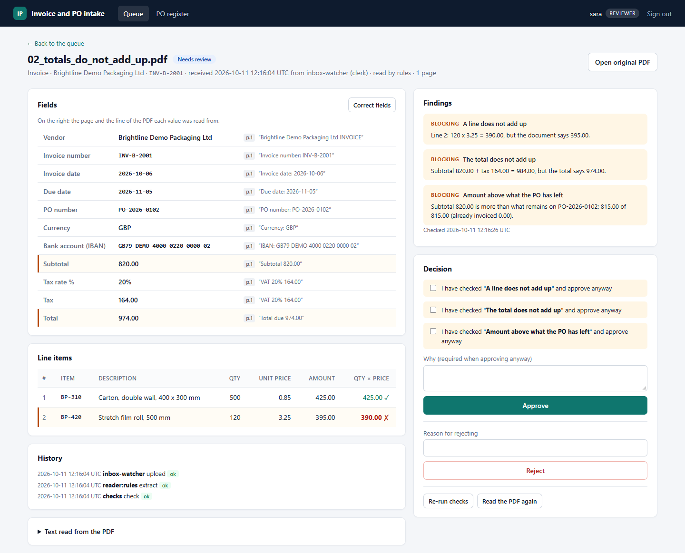
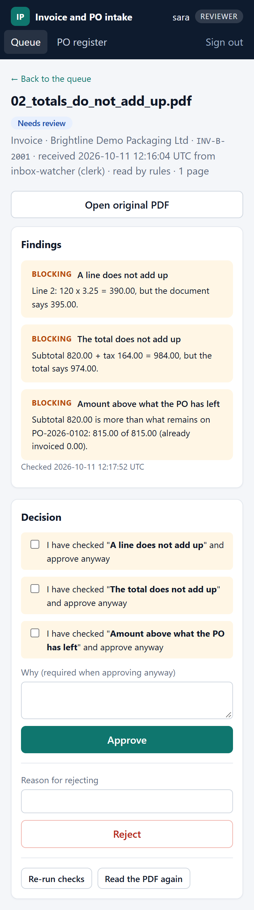

# Invoice and PO Intake



## What it does in 30 seconds

Suppliers send invoices as PDF files. Someone types them into the accounting system, and
the costly mistakes are paying the same invoice twice, paying more than was ordered, and
paying a fraudster who sent "our new bank details".

This tool reads each PDF, checks it, and puts it in front of your accounts payable team
with every problem written out in plain words:

- **The numbers.** Do the lines, the VAT and the total add up?
- **The supplier.** Is it one of your suppliers, and is the bank account the one you have
  on file? An invoice with changed bank details cannot be approved here.
- **The order.** Is there a purchase order, is it for this supplier, and does the invoice
  stay within what was ordered and not yet invoiced?
- **Duplicates.** Has this invoice come in before, even with its number written a little
  differently, or the same amount from the same supplier a few days apart?

Nothing goes to accounting until a person approves it. When a check finds a serious
problem, the reviewer must tick it off and write why before approving, and that note
travels with the invoice. Some problems, like an unknown supplier or changed bank details,
cannot be approved at all. Every step is logged: who uploaded it, who changed what, who
approved it and when.

The reviewer page works on a laptop and on a phone. This is a reference build on fictional
demo documents, not a client system. Today it reads only the demo PDF layout. Reading real
supplier PDFs needs the Claude reader, which is built and tested against a simulated API
but has not been run live. Scans are typed in by a person.

---

## How it is built

| Part | File | What it does |
|---|---|---|
| Intake | `intake/pipeline.py` | Takes PDFs from an inbox folder or an HTTP upload. Stores each file once (by its SHA-256). |
| PDF text | `intake/pdftext.py` | Reads the text layer with pypdf, in separate worker processes with a time limit. |
| Readers | `intake/extract.py` | Turn the PDF into fields and line items: strict rules for the demo layout, or Claude. |
| Checks | `intake/checks.py` | Vendor, bank details, arithmetic, tax, currency, dates, duplicates, match against the PO. |
| Review | `intake/review.py` | Correct a field, approve or reject. The rules for each live here. |
| Export | `intake/export.py` | Writes approved documents to CSV and JSON for an accounting import, never one twice. |
| Server | `intake/server.py` | JSON API and the reviewer web page. A command line client calls the same API. |

The company, its vendors and every document here are fictional demo data. Each name
contains "Demo", every IBAN uses the made-up bank code DEMO, and every postcode starts
with ZZ.

```
 supplier PDF (inbox folder or HTTP upload)
      |
      v
 +-----------------+   no text layer (a scan), password, unknown layout, too slow to parse
 | store once by   | ------------------------------------------------------+
 | SHA-256 hash    |                                                       |
 +-----------------+                                                       |
      | text layer                                                         |
      v                                                                    v
 +-----------------+     +-----------------+     +---------------------------------+
 | reader          | --> | checks (code)   | --> | review queue                    |
 | rules or Claude |     | vendor, bank,   |     | needs_review/needs_manual_entry |
 | fields + where  |     | sums, PO, dups  |     | a reviewer corrects, another    |
 | each was read   |     +-----------------+     | approves or rejects             |
 +-----------------+                             +----------------+----------------+
                                                                  | approved only
                                                                  v
                                                 +---------------------------------+
                                                 | export (admin): CSV + JSON      |
                                                 | each document at most once      |
                                                 +---------------------------------+
```

What the code enforces:

1. **A person approves every document.** The export reads only `approved` documents, and
   only a reviewer can approve. There is no other path from a PDF to the export files.
2. **Approval re-runs the checks** on the values as they are at that moment, holding the
   database write lock, so a second approval on the same PO or a correction cannot slip
   in between. An `error` stops it outright. A `blocking` finding stops it unless the
   reviewer ticks that finding and writes why. A tick names one finding by its id, which
   is made from the finding's code and its message: if the numbers in the message change,
   the old tick no longer counts. The approval also names the version the reviewer looked
   at; if the document changed since, it is refused.
3. **Four eyes.** Whoever typed in or changed any value on a document cannot approve it:
   a field read from the PDF, a field the reader left empty (such as a PO number typed
   onto an invoice that had none), or a line. Another reviewer must (`FOUR_EYES=true`, the
   default). The page greys out the Approve button for that person and says why.
4. **A correction cannot quietly remove a problem.** A value read from the PDF can be
   changed but not deleted, and changing it is itself a blocking finding
   (`value_corrected`). Old and new values are kept.
5. **Bank details are checked, not assumed.** The IBAN, or a UK sort code and account
   number, is compared with the vendor master. A difference is an error, because changed
   bank details are a common invoice fraud pattern, and bank details read from the PDF
   cannot be edited. If none can be read, only half of the UK details can be read (a sort
   code without an account number, or the reverse), the vendor master has none to compare
   with, or a person typed them in, the reviewer must tick it off. A real bank change is
   made in the vendor master through its own process, then the document is checked again.
   Findings name the vendor master's IBAN or account number only by its last four
   characters, and clerks see bank details only that way too.
6. **The readers do not guess.** The rules reader leaves a field empty, with a note, when
   it is not sure. The Claude reader copies each value as printed, with the page and the
   line it came from; code parses the amounts and dates. A number like `1.234` is refused;
   a comma followed by exactly three digits is read as a thousands separator, UK style
   (`1,500` is fifteen hundred), unless it cannot be one (`0,125` is a decimal). A date
   like `05/10/2026` that could be read two ways is a blocking finding. A key value
   (invoice number, PO number, bank details, subtotal, tax, total) or a line item whose
   source line is missing, cannot be found in the PDF's text, or does not show that
   number, is blocking too. A scanned PDF is not read at all: it goes to a person as
   `needs_manual_entry`. So does a PDF that takes longer than `PDF_TIMEOUT_SECONDS` to
   parse; PDFs are parsed in separate worker processes (`PDF_WORKERS`, default 3), so one
   slow file does not hold up the others.
7. **No paying the same thing twice.** The same file is stored once. Invoice numbers are
   compared part by part: case and punctuation are ignored, leading zeros in each part are
   dropped, and O reads as 0, I and L as 1. So `INV-2026-0001` and `INV-2026-001`, or
   `INV-11` and `INV-L1`, are found as the same number. The same vendor and a number
   printed the same way (case and punctuation aside) is an error when the other copy is
   already approved or exported, and blocking while both are waiting. A number that only
   matches after zeros or look-alike letters are set aside is blocking, so a reviewer can
   tell two real invoices apart, unless the other copy is already approved or exported with
   the same total: then it is an error too. The same vendor and total under another
   number is blocking within `DUPLICATE_WINDOW_DAYS` (10), and a warning naming the
   nearest one when further apart, since regular invoices for one amount are normal.
   Invoiced quantities and amounts are counted against the PO, including earlier approved
   invoices. Exports run one at a time, and a document is never exported twice.
8. **The PO register belongs to the ERP.** Invoices are matched against purchase orders
   loaded from the ERP (seed files here). A purchase order document is compared with the
   register on vendor, net amount and number of lines; the lines themselves are not
   compared one by one. Approving a PO document only records that a person checked the
   PDF against the register; the export lists it for purchasing to follow up. It never
   adds to the register or changes it, so nobody in this tool can create the PO that their
   own invoice is then matched against. An invoice without a PO number is blocking
   (`REQUIRE_PO=true`, the default).
9. **Three roles, checked on every route (on the API, before the request body is
   read).** Clerks upload, reviewers decide, admins export and read the audit log. No
   single role can do all three.
10. **Findings are current.** The web page, the API and the command line show a waiting
    document's findings as of the moment they are asked for, and store them only when they
    changed. When a document arrives, is corrected or decided, the documents waiting with
    the same number, PO or total are checked again. A decided document keeps the findings
    it was decided on.
11. **An audit trail.** Every upload, reading, check, correction (old and new value),
    approval, rejection and export, and every refused action by a signed-in user, with who
    and when. API requests without a valid token are refused before the body is read and
    written to the server log.

## Quick start

Needs Python 3.10 or newer. Developed and tested on Windows 11 with Python 3.12 only.
`requirements.txt` is what the server needs; `requirements-dev.txt` adds pytest and fpdf2
for the tests and the sample PDF generator.

PowerShell (Windows):

```powershell
python -m venv .venv
.venv\Scripts\Activate.ps1
pip install -r requirements-dev.txt
python demo.py
python -m pytest -q
```

If PowerShell refuses to run `Activate.ps1`, allow local scripts for your user once with
`Set-ExecutionPolicy -Scope CurrentUser RemoteSigned`, then try again.

Command Prompt (Windows):

```bat
python -m venv .venv
.venv\Scripts\activate.bat
pip install -r requirements-dev.txt
python demo.py
python -m pytest -q
```

bash (Linux, macOS, or Git Bash on Windows):

```bash
python3 -m venv .venv
source .venv/bin/activate          # Git Bash on Windows: source .venv/Scripts/activate
pip install -r requirements-dev.txt
python demo.py
python -m pytest -q
```

On Windows, if `pip` fails with a "path too long" error, move the project to a short
folder such as `C:\src\invoice-po-intake`.

`python demo.py` needs no API key. It starts the server on a free local port with a
throwaway database and folders, and prints twelve short scenes:

1. Every request needs a token, and the role decides what it may do: no token is a 401; a
   clerk trying to approve gets a 403, and that refusal is in the audit log.
2. Six PDFs land in the inbox folder; the watcher reads and checks them.
3. The clerk uploads a purchase order; it is checked against the PO register from the ERP.
4. A clean invoice matches its PO and is approved. The same file sent again is recognised.
5. Totals that do not add up: blocking findings, and the reviewer rejects it.
6. An unknown vendor and changed bank details: errors, which cannot be approved.
7. An invoice above its PO: approved only after each finding is ticked, with a note.
8. A scanned PDF: one reviewer types it in, her own approval is refused (four eyes), and a
   second reviewer approves it.
9. The purchase order agrees with the PO register (vendor, net amount, number of lines) and
   is approved for purchasing to follow up; the register does not change.
10. The supplier sends the first invoice again as a new file: an error, because the first
    copy is already approved. It is rejected.
11. The export: approved documents become CSV and JSON files. A second export finds nothing.
12. The audit log: who did what, and when.

Options: `--pause` stops after each scene (useful when recording); `--serve` keeps the
server running afterwards with one invoice waiting in "To review", and prints the sign-in
tokens; `--keep` keeps the temporary folder with the database and the export files. The
test suite has 246 test cases.

## Running the pieces yourself

Copy `.env.example` to `.env` (PowerShell and bash: `cp .env.example .env`; Command
Prompt: `copy .env.example .env`). The `change-me` tokens work for a local try-out; the
server prints a warning while they are in use and refuses to listen on a public address
with them.

Then, in two terminals (with the virtual environment active in each):

```bash
python -m intake
```
```bash
python -m intake.inbox --watch       # reads PDFs dropped into inbox/ every 10 seconds
```

Copy the demo PDFs into the inbox to have something to review (PowerShell and bash:
`cp samples/pdfs/*.pdf inbox/`; Command Prompt: `copy samples\pdfs\*.pdf inbox\`). Then
open http://127.0.0.1:8200 and sign in with one of the tokens in `INTAKE_TOKENS`, or use
the command line:

```bash
python -m intake.cli list
python -m intake.cli show <document id>          # prints the version and each finding's id
python -m intake.cli approve <document id> --version 1
python -m intake.cli approve <document id> --version 1 --ack <finding id> --note "agreed with the buyer"
python -m intake.cli --token change-me-admin-token-0000000 export
```

The command line uses `INTAKE_TOKEN` and `INTAKE_URL` from `.env` (a reviewer token in the
example). If you start the server with `--port`, change `INTAKE_URL` to match. `upload`
and `read-again` wait up to five minutes for an answer, since reading one PDF with the
Claude reader can take a few; if the wait runs out, the command says so, and `list` shows
the document once it is in. The database, the stored PDFs (`storage/`), the `inbox/` and
the `outbox/` with the export files are created in the current folder and kept between
runs; delete them to start again. The vendor master and the PO register are loaded from
`seed/` into a new database.

The database records its version. Starting a newer version of this code on a database made
by an earlier one adds the columns it lacks, recomputes the lookup keys (for example after
a change to how invoice numbers are compared), notes the upgrade in the audit log, and
carries on; back the file up first. A database made by a newer version is refused with a
message saying so.

### On a phone

The same page adapts to a small screen: the findings and the decision come first, each
document in the queue is a card, and every value still shows where it was read.



### Reading PDFs: rules or Claude

By default the PDFs are read with fixed rules and no AI model. The rules know one layout:
the one in `samples/pdfs`, made by `samples/make_samples.py`. A label they do not expect is
ignored; a table line they cannot read is reported, not interpreted; a value printed twice
with different contents is left empty. That is enough for the demo and needs no key. It is
not meant for real supplier documents, which all look different.

For real documents the intended path is the Claude reader. **It has not been run against
the live API.** It is written and tested against a simulated API: the real Anthropic SDK,
with the network replaced by a mock that answers in the same streamed format.

```bash
# in .env:  ANTHROPIC_API_KEY=...   and   INTAKE_EXTRACTOR=claude
python demo.py --claude
```

How it works:

- One API call per document. The PDF is sent as a document block, and the answer is
  constrained to a JSON schema (structured outputs). Every value comes with the page and
  the line it was read from. The schema has no optional and no union-typed parameters (a
  test counts them against the published limits of 24 and 16). Whether the API accepts
  the schema has not been confirmed live.
- The model copies values as printed (`£1.234,50`, `05/10/2026`). Code turns them into
  amounts and dates, and refuses anything that could mean two things (see point 6 above).
- The default model is `claude-sonnet-5-5` at effort `low`. The reader's settings all
  start with `INTAKE_`, so Claude settings a shell keeps for other tools (Claude Code sets
  `CLAUDE_EFFORT`, for example) are not picked up: `INTAKE_CLAUDE_MODEL`,
  `INTAKE_CLAUDE_EFFORT` (checked against the levels that model accepts) and
  `INTAKE_CLAUDE_FALLBACKS` (`default` or `off`). A wrong value stops the start-up with a
  plain message. The API key is the usual `ANTHROPIC_API_KEY`; without one, the start-up
  stops and says so.
- The answer is streamed with room for 32,000 output tokens, so a long invoice is unlikely
  to be cut off; if it is, the document goes to a person. For models that support it, the
  request asks for Anthropic's server-side fallback, so a safety decline is retried on
  another model.
- At start-up the server checks the key and the model name (a call that bills no tokens)
  and stops with a plain message if either is wrong.
- Each call has a 60 second timeout and one retry. If the API is busy or unreachable, an
  uploaded document goes to the queue as `needs_manual_entry`, where "Read the PDF again"
  tries later, and a file in the inbox stays there for the next scan. The model that
  answered, the token counts and the request id are written to the audit log.

What it might cost per invoice. **This is an estimate, not a measurement.** It assumes a
one-page invoice: about 5,000 to 10,000 input tokens (the instructions and schema;
Anthropic's figure of 1,500 to 3,000 text tokens per page; and the page image, which
current models can count at up to about 4,800 tokens) and 1,000 to 4,000 output tokens
(the JSON answer is about 1,000 on its own; any thinking is billed as output too). Prices
are per million tokens as published by Anthropic (as of October 2026); check them before
quoting.

| Model | Price, input / output | Per invoice | Per 1,000 invoices |
|---|---|---|---|
| `claude-haiku-5-5` | $0.10 / $0.50 | about $0.001 to $0.003 | about $1 to $3 |
| `claude-sonnet-5-5` (default) | $2 / $10 | about $0.02 to $0.06 | about $20 to $60 |
| `claude-opus-5-5` | $4 / $20 | about $0.04 to $0.12 | about $40 to $120 |

Before relying on these numbers, count the tokens of a few real invoices with the API's
token counting endpoint, and compare each model's accuracy on them.

In both modes the reader only fills in fields. It cannot approve, export or call anything,
so text inside a PDF ("pay this today to our new account") is just text. The checks are
ordinary code, and a person approves.

A scanned PDF has no text layer. This build does no OCR: the document goes to the queue as
`needs_manual_entry`, a reviewer types the fields in from the PDF (each one recorded as a
correction), and another reviewer checks and approves it.

## Roles

| Role | Upload | View | Correct, approve, reject | Export | Audit log |
|---|---|---|---|---|---|
| `clerk` | yes | yes (bank details shown as their last four characters) | no | no | no |
| `reviewer` | no | yes | yes | no | no |
| `admin` | no | yes | no | yes | yes |

Tokens and roles are set in `INTAKE_TOKENS`. The API takes the token as
`Authorization: Bearer <token>`. The web page asks for it once on a sign-in form that is
paired with the browser (so another site cannot sign you in), and keeps a session cookie
(HttpOnly, SameSite=Strict, 8 hours; marked Secure when the server listens on a public
address). Its forms carry a CSRF token, and after each action the page redirects, so
reloading it never sends a form twice. When a token is removed from `.env` and the server
restarted, the sessions it opened end too.

## Statuses of a document

| Status | Meaning |
|---|---|
| `needs_review` | read and checked; waiting for a reviewer |
| `needs_manual_entry` | not read (scan, password, unknown layout, too slow, reader failed); a reviewer types it in |
| `approved` | a reviewer approved it; waiting for the next export |
| `rejected` | a reviewer rejected it, with a reason; never exported |
| `exporting` | being written to an export batch; after a crash it stays here until the batch is settled |
| `exported` | in an export batch; never exported again |

## The checks

| Severity | Code | Meaning |
|---|---|---|
| error | `missing_field`, `no_lines`, `line_incomplete` | a required value is empty |
| error | `doc_type_unknown` | not set as an invoice or a purchase order |
| error | `reader_no_text`, `reader_unknown_layout`, `reader_unknown_type` | the reader could not read it; the document goes to manual entry |
| error | `vendor_unknown` | the vendor is not in the vendor master (exact name or a listed alias) |
| error | `bank_changed` | the IBAN, sort code or account number differs from the vendor master |
| error | `bank_invalid` | the IBAN fails its check digits |
| error | `currency_not_allowed` | not in `ALLOWED_CURRENCIES` |
| error | `duplicate_invoice`, `duplicate_po` | the same number, printed the same way (invoices: same vendor and number), is already approved or exported; or, for invoices, a look-alike number with the same total is |
| blocking | `duplicate_invoice`, `duplicate_po` | the same number is also waiting for a decision, or matches an existing one only once zeros and look-alike letters are set aside (purchase orders) |
| blocking | `possible_duplicate` | same vendor and a number that matches only once zeros and look-alike letters are set aside; or same vendor and total within `DUPLICATE_WINDOW_DAYS` (10), under another number |
| warning | `possible_duplicate` | same vendor and total, further apart than the window: names the nearest one |
| blocking | `bank_missing`, `bank_unverified`, `bank_typed` | no bank details, or only a sort code or only an account number, could be read; the vendor master has none to compare with; or a person typed them in |
| blocking | `value_corrected` | a value read from the PDF was changed by a person |
| blocking | `line_math` | qty x unit price is not the line amount (1 penny tolerance) |
| blocking | `subtotal_mismatch`, `tax_mismatch`, `total_mismatch` | the sums do not add up (2 pence tolerance), including pennies that add up over many lines |
| blocking | `tax_rate_unusual` | the rate is not in `TAX_RATES`, or no rate is printed and the tax fits none of them |
| blocking | `date_in_future`, `due_before_invoice` | dated more than 7 days ahead, or due before it was issued |
| blocking | `date_ambiguous` | Claude reader: a date such as `05/10/2026` could be read two ways |
| blocking | `po_missing` | no PO number on the invoice (a warning with `REQUIRE_PO=false`) |
| blocking | `po_not_found`, `po_closed`, `po_vendor_mismatch`, `po_currency_mismatch` | the PO is not in the register, closed, or for someone else |
| blocking | `po_line_not_found`, `po_price_mismatch`, `po_qty_exceeded`, `po_amount_exceeded` | the invoice does not fit the PO (2% price tolerance; quantities and amounts count earlier approved invoices) |
| blocking | `po_not_in_register`, `po_differs` | a purchase order document that is not in the ERP's PO register, or differs from it |
| blocking | `evidence_missing`, `evidence_not_found` | Claude reader: no source line, one not found in the PDF, or one that does not show that number, for the invoice number, PO number, bank details, subtotal, tax, total or a line item (a warning for other fields) |
| warning | `due_missing`, `due_far_out`, `currency_unusual` | worth a look; does not stop approval |
| warning | `reader_conflict`, `reader_unreadable_line`, `reader_invalid_value`, ... | what the reader was unsure about; disappears once that field is corrected |
| warning | `model_concern` | something the Claude reader thought a person should check; stays on the document |
| info | `po_matched`, `po_in_register`, `manual_entry` | how much of the PO remains; a PO document's vendor, net amount and number of lines match the register; why a document needs typing in |

The PO match is a 2-way match: invoice against purchase order. A 3-way match also compares
the goods actually received; that needs goods receipts, which this build does not have.

When a document arrives, is corrected, approved, rejected or read again, the documents
waiting with the same number, PO or total are checked again. A waiting document is also
checked again whenever it is opened, on the web page, through the API or with `cli show`,
so the findings a reviewer sees are current.

## HTTP endpoints

| Endpoint | Who | Purpose |
|---|---|---|
| `GET /healthz` | public | liveness check |
| `POST /api/documents` | clerk | upload one PDF (multipart field `file`, with a Content-Length); `201` new, `200` same file again |
| `POST /api/inbox/scan` | clerk | read what is in the inbox folder now |
| `GET /api/documents?status=open&limit=100&offset=0` | all | the queue (`open`, `all`, or one status), one page at a time, with the `total` |
| `GET /api/documents/{id}` | all | fields, evidence, lines, findings as of now (each with its `id`), corrections, `version`; `?text=true` adds the PDF text (not for clerks) |
| `GET /api/documents/{id}/pdf` | all | the original file |
| `POST /api/documents/{id}/corrections` | reviewer | `{"fields": {"total": "1800.00"}, "lines": [...], "note": "...", "version": 1}` |
| `POST /api/documents/{id}/recheck` | reviewer | run the checks again |
| `POST /api/documents/{id}/read-again` | clerk, reviewer | read the stored PDF again (only while nobody has corrected it) |
| `POST /api/documents/{id}/approve` | reviewer | `{"acknowledge": ["<finding id>"], "note": "...", "version": 1}` |
| `POST /api/documents/{id}/reject` | reviewer | `{"reason": "..."}` |
| `POST /api/exports`, `GET /api/exports` | admin | export approved documents; list batches and the export folder |
| `GET /api/exports/{batch}/{file}` | admin | download one export file |
| `POST /api/exports/{batch}/resolve` | admin | `{"written": true}` settles a batch left in doubt after a crash |
| `GET /api/audit?limit=50` | admin | latest audit entries |
| `GET /api/vendors`, `GET /api/purchase-orders` | all | the vendor master (bank details masked for clerks) and the PO register |

`version` is required on corrections and approvals: it is the version the caller looked
at. Amounts are sent and returned as strings (`"1800.00"`), never as floating point
numbers. JSON bodies are limited to 1 MB, and a chunked body without a Content-Length is
refused.
`python -m intake.cli` is a thin client for these endpoints: `show` prints the version and
each finding's id; `correct` and `approve` require `--version`, and `approve` takes
`--ack <finding id>` once per ticked finding.

## What is in the box

```
intake/pipeline.py     intake: upload and inbox folder, hashing, reading, first check run
intake/pdftext.py      text layer with pypdf, in a pool of worker processes with a time limit
intake/extract.py      PDF -> fields, lines and evidence (strict rules, or Claude)
intake/values.py       parsing and normalising amounts, dates, IBANs, sort codes, numbers
intake/checks.py       every check, each finding with a code, a severity and a plain message
intake/review.py       correct, re-check, read again, approve, reject: the reviewer's rules
intake/export.py       approved documents -> CSV + JSON, at most once (replaceable exporter)
intake/store.py        SQLite: documents, corrections, vendors, PO register, exports, audit log,
                       and the upgrade of a database made by an earlier version
intake/server.py       JSON API and the reviewer web page (templates/, static/)
intake/cli.py          command line client for the API
intake/inbox.py        inbox folder watcher
intake/localrun.py     a local server on a free port, used by the demo and the tests
seed/                  vendor master and PO register (demo data)
samples/               make_samples.py and the nine demo PDFs it generates
demo.py                the whole story in one command
docs/USER_GUIDE.md     for the clerks and reviewers who use it
docs/img/              screenshots of the reviewer page, taken from the running app with the demo PDFs
requirements-dev.txt   requirements.txt plus pytest and fpdf2
tests/                 246 test cases; 47 of them start the server and use real HTTP
```

## What the tests cover, and what they do not

Covered (`python -m pytest -q`):

- **Values:** malformed amounts, printed amounts with a decimal comma or currency sign,
  amounts that could mean two things (`1.234`) and ones that cannot (`0,125`), an amount
  that must appear as a number in its source line, ambiguous dates, IBAN check digits, UK
  sort codes, invoice numbers compared part by part, hidden control characters.
- **Reading:** the rules reader on every demo PDF, and on PDFs that must not be guessed at
  (unknown layout, a value printed twice, an unreadable table line, another date format, a
  scan, a password, a truncated or fake file, too many pages, a PDF too slow to parse); a
  normal PDF read while another worker is busy with a slow one; a PDF that cannot get a
  worker in time (an upload goes to a person, an inbox file waits for the next scan).
- **Checks:** every check with its tolerance boundaries; duplicates through aliases;
  numbers written differently (`INV-2026-0001` and `INV-2026-001`, `INV-11` and `INV-L1`)
  found a month later without a PO, as blocking, not as an error; numbers that only share
  digits not matched; the date window and the warning beyond it; copies of approved
  invoices; PO consumption across invoices; tax without a printed rate; pennies that add up
  over many lines; UK bank details against the master, and half of them not being enough;
  findings that never spell out the master's bank details; PO documents never added to the
  register.
- **Review:** corrections with old and new values, and the rules that stop a correction
  from hiding a finding; ticks by finding id, and ticks that stop counting when the
  finding changes; four eyes, including a value typed into a field the reader left empty;
  stale pages; related documents checked again; findings of a decided document never
  overwritten; errors that cannot be ticked away; four approvals of the same document at
  once; two invoices approved at once against one PO; manual entry of a scan; reading
  again.
- **Export:** four requests at once, a failing writer, both kinds of crash, an exporter
  that cannot tell whether it wrote (left for an admin), formula injection in the CSV.
- **Claude reader:** the exact request through the real SDK and a simulated streamed API;
  the schema counted against the structured output limits; values copied as printed and
  parsed in code; evidence checked against the PDF, including an amount whose quote only
  shares its digits; refusals, cut-off and malformed answers; temporary outages (inbox
  files left for the next scan, read again later); the start-up check, a missing API key,
  wrong settings, and a shell's own `CLAUDE_EFFORT` being ignored; a model that follows an
  instruction printed in the PDF.
- **Database:** an older database upgraded in place (columns added, lookup keys
  recomputed, the upgrade audited); a database from a newer version refused.
- **Over real HTTP:** the token checked before any body is read (raw requests); each role
  refused and audited; uploads (duplicate, empty, fake, too large, no declared size,
  hostile file names); strict ids and raw paths; bank details masked for clerks in the
  vendor master, in a document's fields, findings and text, on the API and on the page;
  the API showing the same current findings as the page and writing only changes; queue
  paging; export downloads; the web page's sign-in pairing, sessions, CSRF, redirect after
  each action, "More empty rows" keeping what was typed, escaping of hostile PDF text,
  security headers; four eyes through two reviewers, with the Approve button off for the
  person who changed a value; the command line client, including document text that
  tries to spoof its output.

Not covered:

- **The live Claude API call.** `ClaudeExtractor` is tested with a simulated API. It has
  not been run against the real API, so its accuracy and cost on real invoices are unknown.
- **Real supplier layouts in rules mode.** The rules reader knows only the demo layout.
- **OCR.** Scanned PDFs are typed in by a person.
- **A real accounting system.** The export writes files; posting them is integration work.
- **Browsers.** The web page is tested at the HTTP level (forms, CSRF, escaping); there are
  no automated browser tests. Its layout was checked by eye in Chrome on Windows, at 1440
  pixels wide and at phone width (375 pixels), as a reviewer and as an admin.
- **The command line's long wait.** That `upload` waits up to five minutes and then says
  the server may still be working is not covered by a test.
- **A memory limit on Windows.** The PDF worker has a time limit everywhere; the memory
  limit uses `RLIMIT_AS`, which exists only on Linux and macOS.
- **Several server processes.** Exports are serialised across processes on one machine;
  approvals rely on SQLite's write lock. Several servers on several machines were not run.
- **Load and long-running behaviour.** No performance or soak tests.
- **Other platforms.** Only Windows 11 with Python 3.12 was run.

## What this is not

It is a first phase: intake, checks, review and a file export. Not included: hosting and
TLS, a connection to an email inbox (PDFs arrive through a folder or an upload), OCR,
credit notes, currency conversion, undoing an approval, approval limits by amount or by
budget holder, payment runs, goods receipts (3-way match), multi-company, and a live link
to the ERP's vendor master and purchase orders (they are seed files here).

## Before using this for real

- Put the server behind HTTPS (a reverse proxy or a platform that terminates TLS). Start it
  with `--host 0.0.0.0 --allowed-host your.domain`; other hostnames are refused and cookies
  are marked Secure.
- Generate long random tokens, one per person and per program, and keep `.env` out of git.
  For single sign-on, replace the token sign-in with your identity provider.
- Add rate limiting on `/login` (the proxy can do it). There is none here.
- Load the vendor master and open purchase orders from the ERP, read-only, instead of the
  seed files. Keep bank detail changes in the ERP's own controlled process.
- Connect the exporter to the accounting system, give it a `was_written` check (look the
  batch up in the target), and use the document id as the external reference, so a retried
  post cannot create a second bill.
- Invoices hold names, addresses and bank details. Decide where the PDFs and the database
  live, who can read them, how long they are kept, and how they are backed up.
- SQLite is fine for one server. For several, move `intake/store.py` to Postgres.
- Before switching the Claude reader on: run it on a sample of real invoices, measure how
  often each field is right and what a document really costs, and agree how its data is
  processed.
- On Linux, run the server in a container or under a memory limit as well; on Windows, the
  PDF worker has only a time limit.
- The original PDF opens in the browser, for clerks too: a clerk who uploads an invoice
  can open it, bank details included, even though the page shows them only masked. If
  supplier PDFs are not trusted, serve them as downloads instead.
- Back up the database before starting a newer version of this code on it; the upgrade
  changes it in place.

## Adapting it to another system

1. **Export.** Write a class with a `name`, a `write(folder, batch, records)` method and,
   if at all possible, `was_written(folder)`; for example one that posts bills to Xero,
   QuickBooks or an ERP. Pass it as `Deps.exporter`. Without `was_written`, a batch
   interrupted by a crash is left for an admin (`python -m intake.cli resolve-export`).
2. **Vendor master and POs.** Replace `Store.load_seed` with a sync from the ERP. The checks
   only use `Store.vendors()` and `Store.po()`.
3. **Rules of the checks.** Tolerances, tax rates, currencies, the duplicate window, the PO
   requirement, the date order and the four-eyes rule are in `.env`. A new check is one
   block in `intake/checks.py` that adds a finding with a code, a severity and a message.
4. **Another reader** (OCR, another model, a supplier's e-invoice format): implement
   `extract(pdf_bytes, pages)` returning an `Extracted`, as in `intake/extract.py`.
5. **3-way match.** Add goods receipts to the store and compare received quantities in the
   PO block of `intake/checks.py`.
